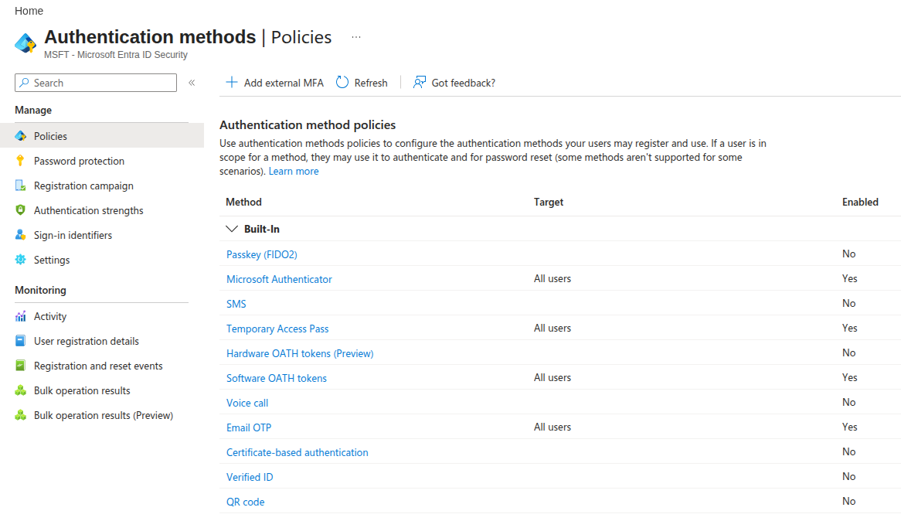
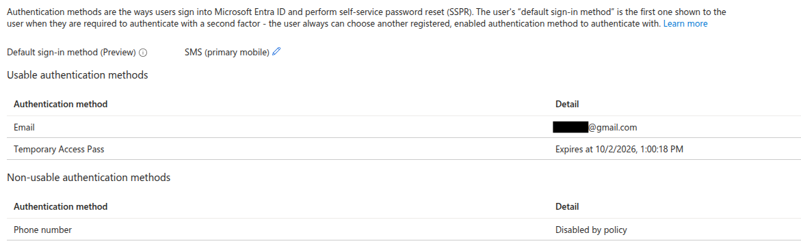

# Registering Authentication Methods to Entra ID Accounts

## Metadata

| Key          | Value                                        |
|--------------|----------------------------------------------|
| ID           | TRR0000                                      |
| External IDs | [T1098.005]                                  |
| Tactics      | Defense Evasion, Persistence                 |
| Platforms    | Azure                                        |
| Contributors | Andrew VanVleet                              |

### Scope Statement

This report covers the registration of authentication methods to Entra ID
accounts.

The following related activity is explicitly out of scope:

- **Obtaining the initial credential.** Every procedure in this report assumes
  the adversary already holds a usable credential for some principal. How that
  credential was obtained is a separate technique.
- **Use of the registered method.** Presenting the method to satisfy a
  multifactor authentication requirement during a later sign-in is the
  consequence of this technique, not part of it.

## Technique Overview

Entra ID satisfies an authentication requirement by checking an authentication
method attached to the user account: an authenticator application, a phone
number, a security key, or a hardware token.

The requirement is only meaningful if the method attached to the account belongs
to the legitimate user. An adversary who can attach their own authentication
method to an account subverts the stronger authentication it's supposed to
provide, because every subsequent multifactor challenge is directed to something
the adversary controls. An authentication method is a property of the account,
so resetting the password leaves the adversary's method in place.

## Technical Background

### Authentication Methods and Registration

An authentication method is the credential a user presents to prove their
identity. Authentication is often referred to as single or multifactor,
reflecting the number of methods used to prove who they are. The more factors
involved -- and the stronger the method used -- the more likely it is that the
user is actually who they claim to be.

In Entra, users register methods through the combined security information
registration experience, which handles registration for both multifactor
authentication and self-service password reset.[^1]

Registering a method is itself a protected operation, and the protections have
tightened over time.[^2][^5] Organizations can additionally apply a Conditional
Access policy to mandate authentication strength.[^6]

An adversary holding only a password cannot generally add an authentication
method to an account that already has one, because the platform will validate
the existing method first. The opportunity exists where no method is present: an
account that has never completed registration, a dormant or newly created
account, or an account for which the adversary holds a credential that itself
satisfies multifactor authentication.

### Entra Authentication Method Policies

Entra allows administrators to configure the authentication method policy for
the tenant. The policy defines which methods are accepted for which groups of
users.

 Entra
allows methods to be registered that are not approved by the policy, but those
methods will not be accepted for authentication.

### Administrative Registration on Behalf of a User

Some authentication method operations are available only to administrators
acting on behalf of another user. For example, users cannot add a phone
authentication method to their own account. It can only be done by an account
with the `Authentication Administrator` or `Privileged Authentication
Administrator` role.[^3]

An administrator can write a method to a target account without having to
demonstrate user control of that method, because the operation is designed for
administrators provisioning credentials for users who cannot do so themselves.
Where the self-service path requires proof of possession, the administrative
path does not.

### Temporary Access Passes

A Temporary Access Pass is a time-limited passcode issued by an administrator
that can satisfy a multifactor authentication requirement. It exists to solve
the bootstrapping problem, allowing a user with no registered method to
authenticate strongly enough to register one.

The same property makes it useful to an adversary. A Temporary Access Pass
obtained for a target account provides a session that is not gated by an
existing method, which restores the registration opportunity even on an account
that would otherwise be protected.

### Telemetry

Authentication method activity is recorded in the Entra ID audit log under both the
`Authentication Methods` and `Core Services` services.[^4]

| Activity | Service | Details |
| --- | --- | --- |
| Admin registered security info | Authentication Methods | Records details about the method registered and the admin and target accounts involved in the event. |
| User registered security info | Authentication Methods | Records details about the method registered and the user account involved. |
| Update user | Core Services | Records a change to the `StrongAuthenticationUserDetails` field for the user. This field lists all registered authenciation methods for the given user at the time of the event. |

## Procedures

| ID | Title | Tactic |
| --- | --- | --- |
| TRR0000.AZR.A | Self-Service Authentication Method Registration | Defense Evasion, Persistence |
| TRR0000.AZR.B | Admin-Initiated Authentication Method Registration | Defense Evasion, Persistence |

### Procedure A: Self-Service Authentication Method Registration

This procedure applies where an adversary holds a credential for an account that
doesn't have an existing strong authenciation method. The first time that anyone
logs in with the credentials, Azure will prompt them to register a new
authentication method. If this is an attacker, then they now control an
authentication method for the account. If the account is subject to a policy
requiring multifactor authentication, the adversary now satisfies that policy,
and the legitimate user may find themselves unable to complete registration of
their own method.

#### Detection Data Model

The operations shown in green are the client, operations in blue are Azure.

### Procedure B: Admin-Initiated Authentication Method Registration

An adversary who controls an account with the
`UserAuthenticationMethod.ReadWrite.All` permission (by default, `Authentiation
Administrator`, `Privileged Authentication Administrator`, and `Global
Administrator`) can write an authentication method to any account in the tenant,
with some limitations: Entra has a safeguard that only allows `Global
Administrators` and `Privileged Authentication Administrators` to make changes
to authentication methods for privileged accounts.

The significant structural difference from Procedure A is the absence of any
proof of possession of the authentication method. The administrative API adds
the method to the target account without requiring the caller to demonstrate
control of it. An adversary therefore attaches a method they control to an
account they may have no other access to, and can subsequently satisfy that
account's multifactor authentication requirement.

#### Detection Data Model

#### Authentication Methods That Can Be Added Administatively

The administrative path is available only for some method types (those that have
a creation operation via the Graph API). The following table records which
methods an administrator can register for another user. Note that Entra will
allow an admin to register an authentication method that is disabled by tenant
policy.

| Method | Registerable on another user | What it gives the adversary |
| --- | --- | --- |
| Phone | Yes | A factor routed to a number the adversary controls |
| Email | Yes | A factor routed to an address the adversary controls, for self-service password reset rather than general multifactor use |
| Temporary Access Pass | Yes | A usable, time-limited credential that satisfies the account's multifactor requirement |
| Software OATH | No | The relationship has no creation operation; a secret is generated only through the authenticator experience, which cannot be performed on another user's behalf |
| FIDO2 security key | No | Creation is inherently self-service: the private key is generated on the user's own authenticator and never leaves it, so an administrator cannot create one they control |
| Microsoft Authenticator | No | No administrative creation operation |
| Windows Hello for Business | No | No administrative creation operation |

The Temporary Access Pass is the most direct of these, because the creation
response returns the pass itself. An administrator therefore obtains a working
credential for the target account without any involvement from the target.

## Available Emulation Tests

| ID            | Link |
|---------------|------|
| TRR0000.AZR.A |      |
| TRR0000.AZR.B |      |

## References

- [Combined security information registration]
- [Protect security info registration]
- [Create phoneMethod]
- [Microsoft Entra audit log categories and activities]

[^1]: [Combined security information registration]
[^2]: [Protect security info registration]
[^3]: [Create phoneMethod]
[^4]: [Microsoft Entra audit log categories and activities]
[^5]: [Mandatory Multifactor Authentication]
[^6]: [Conditional Access Authentication Strengths]

[T1098.005]: https://attack.mitre.org/techniques/T1098/005/
[Combined security information registration]: https://learn.microsoft.com/entra/identity/authentication/concept-registration-mfa-sspr-combined
[Protect security info registration]: https://learn.microsoft.com/entra/identity/conditional-access/policy-all-users-security-info-registration
[Create phoneMethod]: https://learn.microsoft.com/graph/api/authentication-post-phonemethods
[Microsoft Entra audit log categories and activities]: https://learn.microsoft.com/entra/identity/monitoring-health/reference-audit-activities
[Mandatory Multifactor Authentication]: https://learn.microsoft.com/en-us/entra/identity/authentication/concept-mandatory-multifactor-authentication
[Conditional Access Authentication Strengths]: https://learn.microsoft.com/en-us/entra/identity/authentication/concept-authentication-strengths
