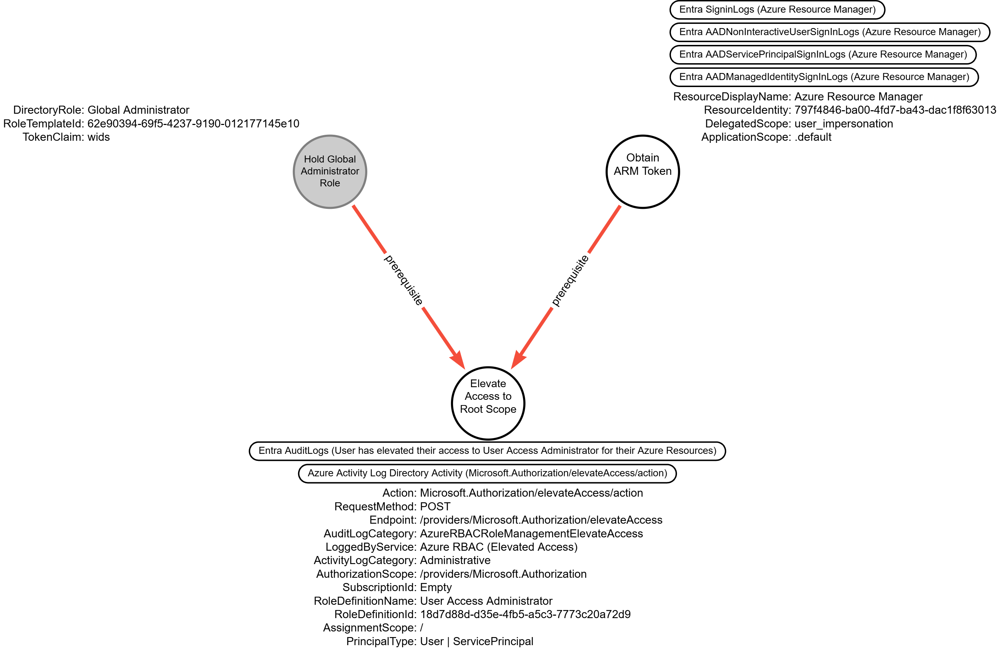

# Elevated Access Toggle (Self-Elevation to Azure Root Scope)

## Metadata

| Key          | Value                             |
|--------------|-----------------------------------|
| ID           | TRR0000                           |
| External IDs | [AZT402], [T1098.003]             |
| Tactics      | Privilege Escalation, Persistence |
| Platforms    | IaaS, Identity Provider           |
| Contributors | John McGuinness                   |

### Scope Statement

A principal holding the Microsoft Entra ID Global Administrator
directory role invokes the Azure Resource Manager action
`Microsoft.Authorization/elevateAccess/action`, causing the platform to
create a User Access Administrator role assignment for that same
principal at Azure root scope `/`.

Direct self-assignment of an Azure RBAC role through
`Microsoft.Authorization/roleAssignments/write` is a separate technique: it
depends on an existing Azure RBAC write permission rather than on an Entra
directory role. Privileged Identity Management activation of an eligible
Global Administrator assignment is one way to meet the Global Administrator
requirement, not an instance of the technique.

## Technique Overview

A principal holding the Microsoft Entra ID Global Administrator directory
role invokes a single Azure Resource Manager action that grants that same
principal the Azure RBAC role User Access Administrator at root scope `/`,
the scope above every management group and subscription in the tenant. The
assignment it creates outlives the directory role that authorized it, which
gives the technique a persistence use as well as a privilege-escalation one.

## Technical Background

### Two Authorization Planes in a Microsoft Entra Tenant

Microsoft Entra ID and Azure resources are secured by two independent
authorization systems. Entra directory roles govern directory objects
such as users, groups, applications, domains, and licensing. Azure RBAC
governs Azure resources through Azure Resource Manager. Microsoft Entra
role assignments do not grant access to Azure resources, Azure role
assignments do not grant access to Microsoft Entra ID, and by default the
Global Administrator does not have access to Azure resources.[^1]

`Microsoft.Authorization/elevateAccess/action` is the mechanism that
carries a directory-plane identity into the resource plane. Elevation is a
Global Administrator capability that no other directory role carries, and
it requires no Azure RBAC permission.[^2]

### Azure Scopes and Root Scope

Azure RBAC scopes nest: resource, resource group, subscription, management
group, and above all of them root scope `/`.[^3] The tenant root management
group sits below `/`, and the assignment the platform creates is scoped to
`/`, not to that group. Custom role definitions cannot be made assignable
at `/`,[^4] so no custom role reaches root scope.

### The Elevate Access Action

The action is a single `POST` to
`/providers/Microsoft.Authorization/elevateAccess` on Azure Resource
Manager.[^5] The request carries no body and no parameter other than
`api-version`, so the caller cannot choose the principal, the role, or the
scope: the platform fixes all three as the caller, User Access Administrator,
and `/`. User Access Administrator reads every Azure resource type and
manages role assignments and role definitions.[^6]

The elevation applies only to the principal that invokes it. Other Global
Administrators in the tenant remain as they were.[^2] The access token
carries the directory role in its `wids` claim,[^7] and Azure Resource
Manager authorizes the call from the presented token rather than from
directory state. A token issued while the role was held therefore satisfies
the check for its remaining lifetime after the role is removed.

### Invocation Surfaces

The portal exposes the action as the `Access management for Azure
resources` toggle under the Microsoft Entra ID `Properties` blade. The same
action is reachable through raw Azure Resource Manager REST, the Azure CLI,
and the management SDKs; every surface resolves to the same action string
against the same endpoint. Azure PowerShell has no elevation cmdlet.[^2]

### Durability and Removal

The assignment the platform creates is an ordinary Azure RBAC role
assignment with no expiry. Deactivating the Global Administrator assignment
in Privileged Identity Management leaves it in place,[^2] and so does
removing the Global Administrator role from the principal.[^8]

Removal is an ordinary `Microsoft.Authorization/roleAssignments/delete`
against the assignment at scope `/`.[^2]

### Telemetry

The caller first obtains an access token whose audience is Azure Resource
Manager, and the sign-in log records that issuance with a
`ResourceDisplayName` of `Azure Resource Manager`. The table depends on the
credential flow. An interactive user sign-in produces
Entra SigninLogs (Azure Resource Manager) telemetry. A token obtained
silently from an existing session (a command-line client or the portal)
produces Entra AADNonInteractiveUserSignInLogs (Azure Resource Manager)
telemetry. A service principal acquiring a client credentials token
produces Entra AADServicePrincipalSignInLogs (Azure Resource Manager)
telemetry, and a managed identity acquiring the token from the instance
metadata endpoint produces
Entra AADManagedIdentitySignInLogs (Azure Resource Manager) telemetry. The
sign-in entry records token issuance rather than the invocation, so a token
already held when the action is invoked produces no sign-in entry at that
moment.

The elevation itself is recorded in two logs, as
Entra AuditLogs (User has elevated their access to User Access
Administrator for their Azure Resources) telemetry and
Azure Activity Log Directory Activity
(Microsoft.Authorization/elevateAccess/action) telemetry.[^2]

The Entra directory audit record lands in the `AuditLogs` table with these
identifying fields:[^9]

- `Category` of `AzureRBACRoleManagementElevateAccess`
- `ActivityDisplayName` of `User has elevated their access to User Access
  Administrator for their Azure Resources`; the later removal carries `The
  role assignment of User Access Administrator has been removed from the
  user`

The Azure Activity Log record is a Directory Activity entry with these
identifying fields:[^10]

- operation display name `Assigns the caller to User Access Administrator
  role`
- `authorization.action` of `Microsoft.Authorization/elevateAccess/action`
- empty `subscriptionId`

The Azure Activity Log record is tenant-level: it belongs to no subscription
or management group, so the diagnostic settings that export the activity
log at those scopes do not carry it, and it is retrieved through a separate
tenant-level REST API.[^10][^8][^11] Reading the tenant-level activity
log requires an Azure role assignment at scope `/`, and that assignment
must be made by a Global Administrator with elevated access.[^12]

The two records identify the caller differently. The Activity Log `caller`
field carries a user principal name for a user and a bare object identifier
for a service principal; the audit record's `InitiatedBy` populates `user`
for a user and `app.servicePrincipalId` for a workload identity.

Microsoft Defender for Resource Manager, a plan enabled per
subscription,[^13] lists the alert `ARM_AnomalousElevateAccess`
(`Suspicious elevate access operation`) for an elevate access operation it
identifies as suspicious.[^14]

> [!NOTE]
>
> One invocation produces two Azure Activity Log records, a `Started` record
> and a `Succeeded` record sharing an operation identifier, and one Entra
> directory audit record stamped at the same moment as the `Succeeded`
> record. Repeat invocation by an already elevated principal produces a
> further full set of records while leaving the existing assignment in
> place.

## Procedures

| ID            | Title                              | Tactic                            |
|---------------|------------------------------------|-----------------------------------|
| TRR0000.AZR.A | Self-Elevation to Azure Root Scope | Privilege Escalation, Persistence |

### Procedure A: Self-Elevation to Azure Root Scope (TRR0000.AZR.A)

There is one procedure because the request exposes nothing to vary. Every
surface in [Invocation Surfaces] emits the same action against the same
endpoint, and the credential flow behind the token changes which sign-in
table records the issuance and how the records identify the caller, not
which operations the technique performs. The portal, the CLI, raw REST, the
SDKs, and a workload identity holding the directory role are therefore
instances of one path. The two operations are `Obtain ARM Token` and
`Elevate Access to Root Scope`; the platform creates the role assignment
inside the second, so it is not a separate operation. The records of both
are described in [Telemetry].

#### Detection Data Model

## Available Emulation Tests

| ID                                                       | Link                                              |
|----------------------------------------------------------|---------------------------------------------------|
| azure.privilege-escalation.root-user-access-administrator | [Stratus Red Team Root User Access Administrator] |

## References

- [Azure Threat Research Matrix AZT402]
- [MITRE ATT&CK T1098.003]
- [Elevate Access to Manage Azure Subscriptions - Microsoft Learn]
- [Global Administrator Elevate Access REST API - Microsoft Learn]
- [Azure Roles and Microsoft Entra Roles - Microsoft Learn]
- [Microsoft Entra Audit Activity Reference - Microsoft Learn]
- [SigninLogs Table Schema - Microsoft Learn]
- [AADNonInteractiveUserSignInLogs Table Schema - Microsoft Learn]
- [AADServicePrincipalSignInLogs Table Schema - Microsoft Learn]
- [AADManagedIdentitySignInLogs Table Schema - Microsoft Learn]
- [Azure Monitor Activity Log - Microsoft Learn]
- [Defender for Cloud Resource Manager Alerts - Microsoft Learn]
- [Azure Apex Permissions Elevate Access - Permiso]
- [Microsoft Entra Elevated Access Logs - Chance of Security]
- [Storm-0501 Evolving Techniques - Microsoft Security Blog]
- [MITRE ATT&CK Scattered Spider Group]
- [Stratus Red Team Root User Access Administrator]

[Telemetry]: #telemetry
[Invocation Surfaces]: #invocation-surfaces
[AZT402]: https://microsoft.github.io/Azure-Threat-Research-Matrix/PrivilegeEscalation/AZT402/AZT402/
[T1098.003]: https://attack.mitre.org/techniques/T1098/003/
[Azure Threat Research Matrix AZT402]: https://microsoft.github.io/Azure-Threat-Research-Matrix/PrivilegeEscalation/AZT402/AZT402/
[MITRE ATT&CK T1098.003]: https://attack.mitre.org/techniques/T1098/003/
[MITRE ATT&CK Scattered Spider Group]: https://attack.mitre.org/groups/G1015/
[Elevate Access to Manage Azure Subscriptions - Microsoft Learn]: https://learn.microsoft.com/azure/role-based-access-control/elevate-access-global-admin
[Global Administrator Elevate Access REST API - Microsoft Learn]: https://learn.microsoft.com/en-us/rest/api/authorization/global-administrator/elevate-access
[Azure Roles and Microsoft Entra Roles - Microsoft Learn]: https://learn.microsoft.com/azure/role-based-access-control/rbac-and-directory-admin-roles
[Microsoft Entra Audit Activity Reference - Microsoft Learn]: https://learn.microsoft.com/entra/identity/monitoring-health/reference-audit-activities#azure-rbac-elevated-access
[SigninLogs Table Schema - Microsoft Learn]: https://learn.microsoft.com/azure/azure-monitor/reference/tables/signinlogs
[AADNonInteractiveUserSignInLogs Table Schema - Microsoft Learn]: https://learn.microsoft.com/azure/azure-monitor/reference/tables/aadnoninteractiveusersigninlogs
[AADServicePrincipalSignInLogs Table Schema - Microsoft Learn]: https://learn.microsoft.com/azure/azure-monitor/reference/tables/aadserviceprincipalsigninlogs
[AADManagedIdentitySignInLogs Table Schema - Microsoft Learn]: https://learn.microsoft.com/azure/azure-monitor/reference/tables/aadmanagedidentitysigninlogs
[Azure Monitor Activity Log - Microsoft Learn]: https://learn.microsoft.com/azure/azure-monitor/platform/activity-log
[Defender for Cloud Resource Manager Alerts - Microsoft Learn]: https://learn.microsoft.com/azure/defender-for-cloud/alerts-resource-manager
[Storm-0501 Evolving Techniques - Microsoft Security Blog]: https://www.microsoft.com/en-us/security/blog/2025/08/27/storm-0501s-evolving-techniques-lead-to-cloud-based-ransomware/
[Azure Apex Permissions Elevate Access - Permiso]: https://permiso.io/blog/azures-apex-permissions-elevate-access-the-logs-security-teams-overlook
[Microsoft Entra Elevated Access Logs - Chance of Security]: https://www.chanceofsecurity.com/post/microsoft-entra-elevated-access-logs-better-security-better-insights
[Stratus Red Team Root User Access Administrator]: https://stratus-red-team.cloud/attack-techniques/azure/azure.privilege-escalation.root-user-access-administrator/

[^1]: [Azure Roles and Microsoft Entra Roles - Microsoft Learn](https://learn.microsoft.com/azure/role-based-access-control/rbac-and-directory-admin-roles)
[^2]: [Elevate Access to Manage Azure Subscriptions - Microsoft Learn](https://learn.microsoft.com/azure/role-based-access-control/elevate-access-global-admin)
[^3]: [Azure RBAC Scope Overview - Microsoft Learn](https://learn.microsoft.com/azure/role-based-access-control/scope-overview)
[^4]: [Azure Custom Role Limits - Microsoft Learn](https://learn.microsoft.com/azure/role-based-access-control/custom-roles#custom-role-limits)
[^5]: [Global Administrator Elevate Access REST API - Microsoft Learn](https://learn.microsoft.com/en-us/rest/api/authorization/global-administrator/elevate-access)
[^6]: [Azure Built-in Roles Privileged - Microsoft Learn](https://learn.microsoft.com/azure/role-based-access-control/built-in-roles/privileged#user-access-administrator)
[^7]: [Access Token Claims Reference - Microsoft Learn](https://learn.microsoft.com/entra/identity-platform/access-token-claims-reference)
[^8]: [Azure Apex Permissions Elevate Access - Permiso](https://permiso.io/blog/azures-apex-permissions-elevate-access-the-logs-security-teams-overlook)
[^9]: [Microsoft Entra Audit Activity Reference - Microsoft Learn](https://learn.microsoft.com/entra/identity/monitoring-health/reference-audit-activities#azure-rbac-elevated-access)
[^10]: [Azure Monitor Activity Log - Microsoft Learn](https://learn.microsoft.com/azure/azure-monitor/platform/activity-log)
[^11]: [Microsoft Entra Elevated Access Logs - Chance of Security](https://www.chanceofsecurity.com/post/microsoft-entra-elevated-access-logs-better-security-better-insights)
[^12]: [Azure Lighthouse Monitor Delegation Changes - Microsoft Learn](https://learn.microsoft.com/azure/lighthouse/how-to/monitor-delegation-changes)
[^13]: [Enable Defender for Resource Manager - Microsoft Learn](https://learn.microsoft.com/azure/defender-for-cloud/tutorial-enable-resource-manager-plan)
[^14]: [Defender for Cloud Resource Manager Alerts - Microsoft Learn](https://learn.microsoft.com/azure/defender-for-cloud/alerts-resource-manager)
