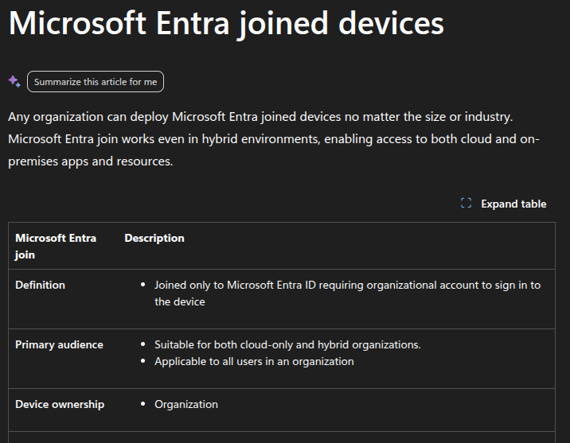
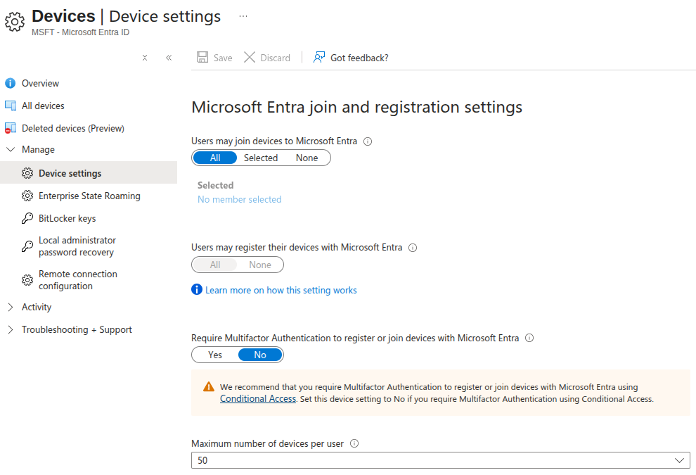
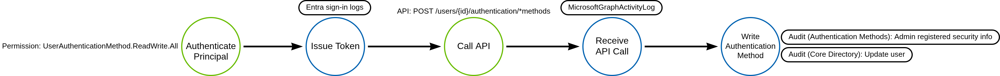

# Registering Devices to Entra ID

## Metadata

| Key          | Value                                        |
|--------------|----------------------------------------------|
| ID           | TRR0000                                      |
| External IDs | [T1098.005]                                  |
| Tactics      | Defense Evasion                              |
| Platforms    | Azure                                        |
| Contributors | Andrew VanVleet                              |

### Scope Statement

This report covers the creation of device identities in Entra ID: directory
objects representing a machine, bound to key material held by whoever performed
the registration.

The following related activities are explicitly out of scope:

- **Obtaining the initial credential.** Every procedure in this report assumes
  the adversary already holds a usable credential for some principal. How that
  credential was obtained is a separate technique.
- **Registration of authentication methods.** Attaching a credential that
  satisfies a multifactor authentication requirement to a user account is a
  separate technique with distinct operations.
- **Use of a Primary Refresh Token after it has been issued.** Requesting the
  token is included as the terminal operation of both procedures, but replaying,
  extracting, or presenting the token to access resources is a separate
  technique.
- **Microsoft Entra hybrid join.** Hybrid join requires an on-premises Active
  Directory as the primary identity source and device writeback through
  Microsoft Entra Connect. That is a materially different execution path and is
  not reachable by an adversary holding only cloud credentials.
- **Achieving device compliance.** Satisfying a Conditional Access policy that
  requires a compliant device requires enrollment in a mobile device management
  service and the assignment of a compliance state, both of which are additional
  operations belonging to other techniques.

## Technique Overview

A device identity is a directory object representing a machine known to the
tenant. Organizations can use device identities to distinguish machines they
know from machines they do not; it is also possible to grant access on that basis.

Unlike many attack techniques, device registration in Entra does not yield an
automatic gain. An adversary performing it already holds a credential for an
account in the tenant, and holds no more privilege afterwards than before. What
changes is that the adversary's machine becomes one the directory recognizes,
with an identifier, a name, a registered owner, and a trust type.

The value of that change depends on the environment. Where an organization has
built policy based on device identities, an adversary can grant their device a
potentially trusted identity. Where no such policy exists, the technique
provides little. The device credential cannot be used to obtain an access or
refresh token by itself; every request for a Primary Refresh Token (PRT) also
carries a user credential.

The real value of this technique lies in the inconsistency between Microsoft's
documentation and the actual technical implementation. Microsoft's documentation
states: "A device identity gives administrators information they can use when
making access or configuration decisions."[^1] Documentation on Entra-joined
devices indicates that they are owned by the organization and signed in to with
a Microsoft Entra account. It reiterates: "Access to resources can be controlled
based on your account and Conditional Access policies applied to the
device."[^2]



However, while there are configurations where those descriptions apply, they are
not enforced. By the default configuration, the only thing that is verified when
a device is registered is that the registering entity holds a valid username and
password for a user in the tenant. This could lead defenders to build policies
based on inaccurate expectations, setting the stage for an adversary to register
a device and abuse those expectations.

## Technical Background

### Device identities

A device identity is a directory object in Entra ID that represents a machine.
Device identities are a prerequisite for device-based Conditional Access
policies.[^1] There are three types, distinguished by how the machine is signed
in to and who owns it. This is how Microsoft describes them:

- **Microsoft Entra registered** - Typically a personal or bring-your-own
  device. The machine is signed in to using a local account, such as a Microsoft
  account, and the work identity is added separately for access to
  resources.[^2] These objects carry a `trustType` of `Workplace`.[^3]
- **Microsoft Entra joined** - An organization-owned machine where the Entra ID
  account is used to sign in to the device itself.[^1] These objects carry a
  `trustType` of `AzureAd`.[^3]
- **Microsoft Entra hybrid joined** - Joined to on-premises Active Directory and
  registered with Entra ID. These objects carry a `trustType` of `ServerAd`.[^3]

The distinction between registered and joined is simply a field set in the
registration request. Both are produced by the same service through the same
exchange with the same level of validation.

```text
JoinType: 4  -->  trustType "Workplace"   (Entra registered)
JoinType: 0  -->  trustType "AzureAd"     (Entra joined)
```

A device object is not an independent entity. The account whose credential was
used to perform the registration becomes the device's registered owner, and
additional accounts may be associated with the device as registered users.

### The Device Registration Service

Device identities are created by the Microsoft Entra Device Registration Service
(DRS, application identifier of `01cb2876-7ebd-4aa4-9cc9-d28bd4d359a9`).[^5] The
requestor generates a device key pair and a transport key, constructs a
certificate signing request, and submits it to DRS along with a token
identifying the user. DRS validates the token, creates a device identifier, and
creates a certificate that is returned to the client.[^4] The device key is
generated on the client and never leaves it, which means the resulting device
identity is bound to key material held by whoever performed the registration.

Several tenant settings govern who may create device identities and under what
conditions. They are held in a single tenant-wide device registration policy.
Registration and join permissions are configured separately, and a per-user
device quota defaults to 50 devices. Most significantly, the setting requiring
multifactor authentication in order to register or join a device defaults to
`No`.[^3] In a tenant that has not changed this default, a primary credential
alone is sufficient to create a device identity.



### Primary Refresh Tokens

A Primary Refresh Token (PRT) is a credential issued to a device + user
combination that enables single sign-on across applications on that device. It
can be submitted to Entra to obtain an access token for a specific resource.[^6]
(Conceptually, this is similar to Kerberos' `ticket granting ticket` (TGT), but
with improvements.)

PRTs are used for:

- Single Sign-On (SSO) - Once a user signs into their device, the PRT allows
  them to access Microsoft 365, Azure, and other cloud apps without requiring
  the user to reenter their credentials. Apps like Office, Microsoft Edge, and
  Teams use the PRT via a broker to silently authenticate users, improving the
  user experience, reducing the need for multiple sign-ins.
- Token Acquisition - The PRT is used to request access tokens and refresh
  tokens for various services (like Outlook, Teams, SharePoint, etc.) via the
  Windows Web Account Manager (WAM) or Broker plug-ins on other platforms.
- Conditional Access Compliance - It carries device and user claims, which are
  evaluated by Entra ID to enforce Conditional Access policies (for example,
  requiring compliant devices, MFA, etc.).

When a device is registered, a Primary Refresh Token (PRT) is issued for a
particular user on a particular device. A PRT can also be requested later using
the device certificate. PRTs can be bound to the device (meaning they are stored
in the Trusted Platform Module or TPM) or unbound (not TPM protected).

PRTs requested with a known device certificate result in a PRT that carries an
`rsa` claim in the authentication methods (`amr`) field, indicating that the PRT
is being issued to a device known by the tenant.

PRTs are long-lived credentials, lasting for 14 or 90 days. (There is some
disagreement between documentation and testing results on the actual lifetime of
a PRT. Documentation says 90 days, PRTs obtained in testing expired in 14 days.)

#### How the token is obtained

Obtaining a PRT is a three-part exchange with the token endpoint. The client
first requests a nonce, which binds the exchange to a single attempt. It then
builds an assertion carrying that nonce and a user credential, signs the
assertion with the device private key, and includes the device certificate so
that the service can identify which device is asking. The signature is what
proves possession of the key generated during registration, and is the basis on
which the service treats the request as coming from that device.

Two things follow from the shape of that exchange. The device key alone obtains
nothing, because every request also carries a user credential; and the
credential alone obtains nothing (in this context), because the request must be
signed by a key the service associates with a device object. The two are
required together.

The response returns the PRT, an identity token describing the authentication
that produced it, and a session key encrypted to the transport key submitted
during registration. The session key is required to use the token for single
sign-on, a request that presents the token without signing it with the session
key is rejected. (The session key is not required to establish that the token
was issued or to read the claims it was issued against.)

The session key is recoverable only with the transport private key generated
during registration. An adversary who performs the registration holds all three
(the token, the session key, and the transport key), but a token separated from
that key material is not directly usable.

#### Token Revocation

Entra ID does not maintain a list of issued tokens and revoke them individually.
It records a single `TokensValidFrom` timestamp on the user object, and refuses
any refresh-class token whose issue time precedes it.[^13] Actions described as
revoking a user's sessions operate by advancing that timestamp.

The check applies only to refresh-class tokens. Access tokens already obtained
continue to be honoured until they expire on their own schedule, so advancing
the timestamp does not immediately withdraw access the holder has already
acquired.[^11]

> [!WARNING]
>
> Testing showed that an administrative password reset -- which issues a
> temporary password for the user and requires them to change their password at
> their next sign-in -- did not advance the timestamp. A token issued beforehand
> was still redeemed successfully afterwards. The timestamp advanced only when
> the user logged in and set a password of their own.
>
> Because resetting a compromised account's password does not by itself end
> sessions established with the previous one, the sessions must be explicitly
> revoked (i.e. an action that immediately advances the timestamp) or the
> corresponding device must be disabled.

### Conditional Access and Device Identities

> [!NOTE]
>
> Conditional Access policies are not evaluated when a PRT is issued; they are
> evaluated when a PRT is used to request an access token for a specific
> resource.[^6]

A device identity can be used in Conditional Access policies in two ways:

#### Grant Controls

Grant controls can be used to block or grant access according to specific
conditions, like requiring multifactor authentication or use of a specific
approved application. There is a grant control for requiring a compliant device
and one for requiring a hybrid-joined device. There is no grant control that
requires a registered or joined device[^7].

Of note, a device identity is not an additional factor for satisfying a
multifactor authentication requirement.

#### Filter Conditions

A device object carries attributes that Conditional Access device filters and
dynamic group rules can evaluate to grant or block access. These filterable
attributes fall into 3 groups:

- **Group 1** — supplied by the registering client, and therefore
  attacker-controlled: `displayName`, `operatingSystem`,
  `operatingSystemVersion`, `manufacturer`, `model`, `deviceMetadata`, and
  `trustType`

- **Group 2** — set by the management plane, theoretically requiring Intune
  enrollment (but see the note below): `isCompliant`, `mdmAppId`,
  `enrollmentProfileName`, `deviceCategory`,
  `extensionAttribute1-15`, `deviceOwnership`. If a device is not managed, these
  values should be unset.

- **Group 3** — applied by DRS at registration: `systemLabels`, `physicalIds`,
  `registrationDateTime`, `deviceId`.

> [!WARNING]
>
> In theory, the values in group 2 are set by enrolling the device in Intune and
> complying with the required policies. However, a user with `Intune Administrator`
> or `Global Administrator` in Entra can use the Graph API (or
> AADInternals[^14]) or PowerShell's Entra Management `Set-EntraDevice` cmdlet
> to manually set these fields, including `isManaged` and `isCompliant`. An
> attacker possessing those roles can modify a device identity to make it appear
> managed and compliant, allowing them to pass conditional access policies
> requiring managed or compliant devices.

A less obvious effect concerns devices that do not exist in the directory at
all. For a device unregistered with Entra ID, all device properties are
evaluated as null and the device attributes cannot be determined; Microsoft's
guidance is accordingly to target unregistered devices using negative
operators.[^12] The existence of a device object could therefore change how a
filter evaluates, independent of the values it carries. Creating a device
identity moves the machine out of the unregistered category, which is the
category a restrictive policy may be written to address.

### Bulk enrollment tokens

A bulk enrollment token allows many Windows devices to be joined to a tenant and
enrolled in management from a provisioning package, without an individual user
signing in to each machine.[^8] Creating one requires a supported Entra role
assignment and membership in the mobile device management user scope.[^9]

Two properties make the token notable. First, the account used to obtain it must
authenticate with a password or certificate-based authentication, because other
authentication methods are not supported,[^8] which means the token is obtained
through a flow that structurally cannot involve multifactor authentication.
Second, the token corresponds to a dedicated directory identity rather than to
the human who created it, so devices registered with it are owned by that
identity.

### Telemetry

| Operation | Log source | Record |
| --- | --- | --- |
| Issue Token | Sign-in logs | Authentication to the Device Registration Service resource (`01cb2876-7ebd-4aa4-9cc9-d28bd4d359a9`). Carries the authentication requirement satisfied. Device details are empty, as the object does not yet exist. |
| Create Device Object | Audit logs | `Register device` with the Device Registration Service. |
| Create Device Object | Audit logs | `Add device` with the Core Directory |
| Issue PRT | Sign-in logs, interactive | Interactive when a password is presented. Application: Microsoft Authentication Broker, resource: Windows Azure Active Directory, protocol recorded as resource owner password credentials (ROPC). |
| Issue PRT | Sign-in logs, non-interactive | Non-interactive when a refresh token is presented. Same application and resource, no protocol recorded. |

## Procedures

| ID            | Title                                                   | Tactic          |
|---------------|---------------------------------------------------------|-----------------|
| TRR0000.AZR.A | Device Registration via the Device Registration Service | Defense Evasion |
| TRR0000.AZR.B | Bulk Device Registration via a Bulk Enrollment Token    | Defense Evasion |

### Procedure A: Device Registration via the Device Registration Service

This procedure applies where an adversary holds a valid credential or refresh
token for any account permitted to register or join devices. It does not require
administrative privilege, and in a tenant retaining the default configuration it
does not require multifactor authentication.

The adversary authenticates and obtains a token. On a machine under their
control they generate a device key pair and a transport key. These keys are
generated locally and never transmitted, so this operation produces no record
within the tenant. The adversary constructs a certificate signing request (CSR)
and submits it to the Device Registration Service (DRS) together with the token.
DRS validates the token, creates a device object in the directory, and issues a
certificate signed by the device key.

The adversary now possesses a device identity in the tenant whose private key
material they hold exclusively. They can then request a PRT for the device,
which Entra ID issues carrying device and user claims.

#### Detection Data Model


### Procedure B: Bulk Device Registration via a Bulk Enrollment Token

This procedure differs from Procedure A by the credential used to perform the
registration and by the operations required to obtain it. Rather than
registering a device as a specific user, the adversary first obtains a bulk
enrollment token and then uses it to register devices.

The adversary authenticates as a principal holding a supported directory role
and within the mobile device management user scope, using a password or
certificate-based authentication. They request a bulk enrollment token. Entra ID
creates a directory identity to represent the token and issues the token itself.
This identity, rather than any human user, becomes the owner of devices
subsequently registered.

With the token in hand, the remaining operations mirror Procedure A: keys are
generated on a machine under the adversary's control, a registration request is
submitted to the Device Registration Service authenticated by the bulk token, a
device object is created, and a certificate is issued.

Two consequences distinguish this path. The token is reusable, so a single
acquisition supports the registration of many devices, bounded by the tenant's
device quota. And because the flow that produces the token cannot involve
multifactor authentication, this path is structurally exempt from multifactor
requirements at the point of registration.

#### Detection Data Model



## Available Emulation Tests

| ID            | Link |
|---------------|------|
| TRR0000.AZR.A |      |
| TRR0000.AZR.B |      |

## References

- [What is a device identity?]
- [How it works: Device registration]
- [What is a Primary Refresh Token?]
- [Manage device identities]
- [Microsoft Entra security operations for devices]
- [Revoke user access in an emergency]
- [Conditional Access: Filter for devices]
- [Revoke-EntraSignedInUserAllRefreshToken]
- [BPRT unleashed]

[^1]: [What is a device identity?]
[^2]: [Microsoft Entra registered devices]
[^3]: [Manage device identities]
[^4]: [How it works: Device registration]
[^5]: [Conditional Access: Authentication flows]
[^6]: [What is a Primary Refresh Token?]
[^7]: [Conditional Access: Grant]
[^8]: [Bulk enrollment for Windows devices]
[^9]: [Enrollment with provisioning packages]
[^11]: [Revoke user access in an emergency]
[^12]: [Conditional Access: Filter for devices]
[^13]: [Revoke-EntraSignedInUserAllRefreshToken]
[^14]: [Faking Device Compliance]

[T1098.005]: https://attack.mitre.org/techniques/T1098/005/
[What is a device identity?]: https://learn.microsoft.com/entra/identity/devices/overview
[Microsoft Entra registered devices]: https://learn.microsoft.com/entra/identity/devices/concept-device-registration
[Manage device identities]: https://learn.microsoft.com/entra/identity/devices/manage-device-identities
[How it works: Device registration]: https://learn.microsoft.com/entra/identity/devices/device-registration-how-it-works
[What is a Primary Refresh Token?]: https://learn.microsoft.com/entra/identity/devices/concept-primary-refresh-token
[Conditional Access: Grant]: https://learn.microsoft.com/entra/identity/conditional-access/concept-conditional-access-grant
[Conditional Access: Authentication flows]: https://learn.microsoft.com/entra/identity/conditional-access/concept-authentication-flows
[Bulk enrollment for Windows devices]: https://learn.microsoft.com/intune/device-enrollment/windows/create-bulk-package
[Enrollment with provisioning packages]: https://learn.microsoft.com/intune/solutions/education/tutorial-school-deployment/enroll-package
[Microsoft Entra security operations for devices]: https://learn.microsoft.com/entra/architecture/security-operations-devices
[Revoke user access in an emergency]: https://learn.microsoft.com/entra/identity/users/users-revoke-access
[Conditional Access: Filter for devices]: https://learn.microsoft.com/entra/identity/conditional-access/concept-condition-filters-for-devices
[Revoke-EntraSignedInUserAllRefreshToken]: https://learn.microsoft.com/powershell/module/microsoft.entra.authentication/revoke-entrasignedinuserallrefreshtoken
[BPRT unleashed]: https://aadinternals.com/post/bprt/
[Faking Device Compliance]: https://aadinternals.com/post/mdm/
